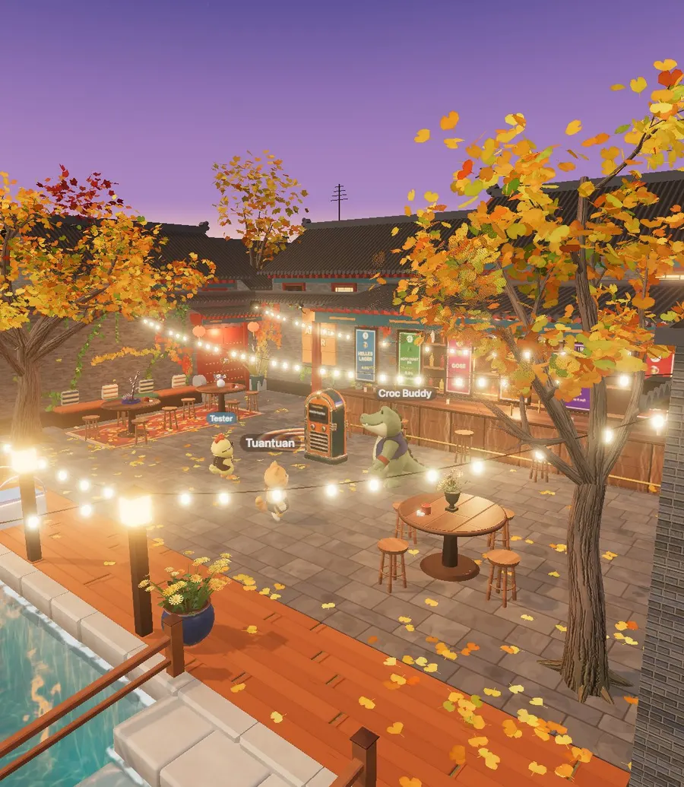
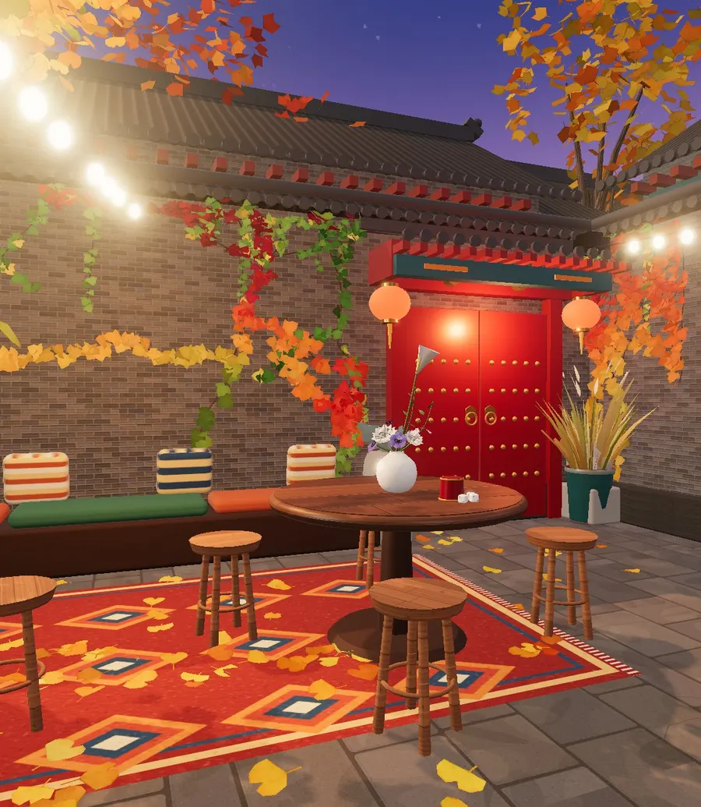
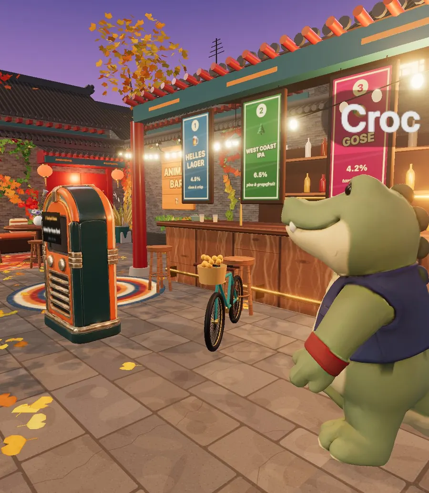
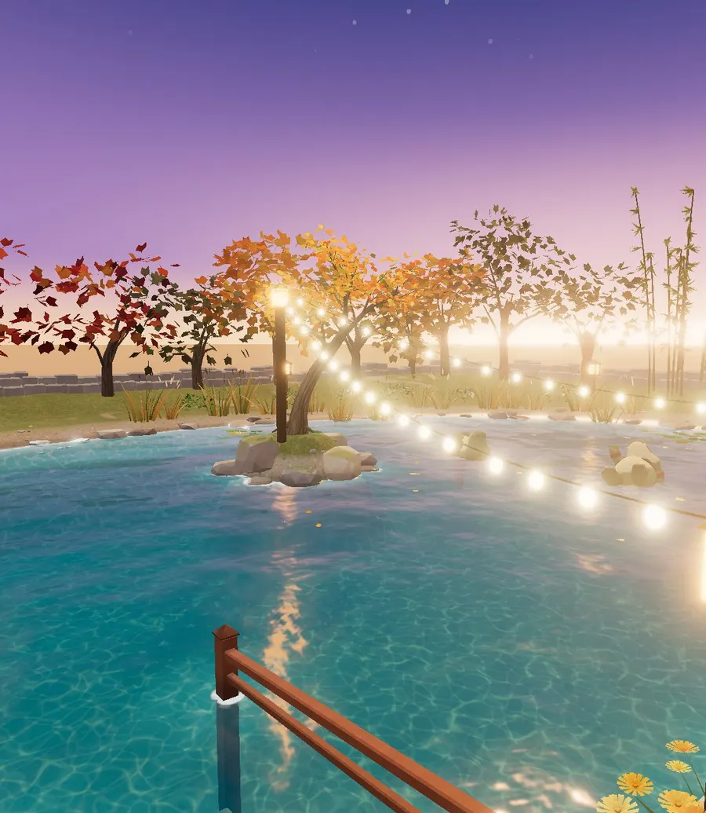
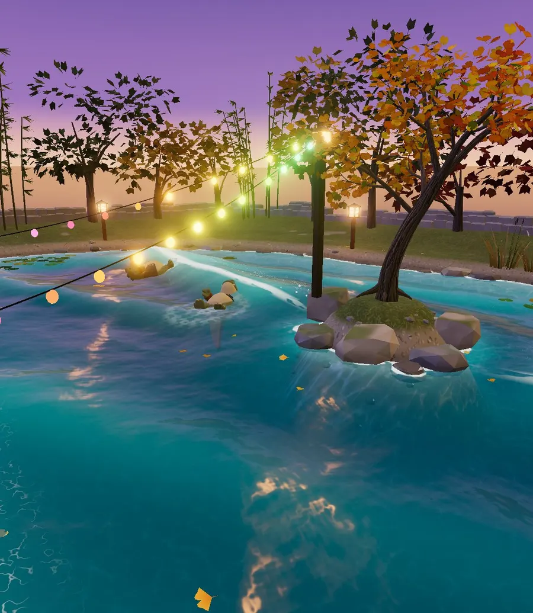

# Animal Bar · 动物酒馆

**A little Beijing hutong bar, run by animals, open all night in your browser.**

Push open the red door of a courtyard in an old Beijing alley. Grey-brick walls with tiled copings, red
lacquered pillars and paper lanterns, string lights across the yard, ginkgo trees dropping golden leaves on
the paving stones. There is a jukebox in the middle of the yard, a bicycle leaning by the bar, a little lagoon
behind the deck, and a cat and a crocodile behind the counter.

Pick an animal, give yourself a name, and come in. Whoever else is there is really there.



## What is a hutong?

Hutongs (胡同) are the narrow alleys of old Beijing, lined with courtyard homes behind grey walls and red
gates. Neighbours sit outside on summer nights, bicycles squeeze past each other, ginkgo leaves turn the
lanes gold every autumn, and lately some of those courtyards have become tiny bars where everyone ends up
talking to everyone. Animal Bar is a love letter to that feeling, for people who have never been there and
for people who miss it.



## Things to do

- **Put a song on the jukebox.** It is shared: everyone in the yard hears the same song at the same moment,
  with a queue anyone can add to. Mute or listen on your own device.
- **Ride the bicycle.** The yard's old bike with a basket of oranges. You hit harder on a bike, but anyone
  who rams you knocks you off it, and then it's theirs. The longest rider is the bike king.
- **Kick through the ginkgo leaves.** They fall, drift, float on the lagoon and burst when you cheer.
- **Chat.** A public chat room with everyone who's in the yard; your name floats over your head.
- **Ask Tuantuan the cat for a drink.** Four odd questions (none about what you like to drink), then flip a
  card: you get a persona title and a craft beer. Collect all seventeen cards.
- **Play liar's dice** at the tables, the Cantonese bar way: bid, open, double, re-double. Alone, the cat and
  the croc will play with you.
- **Jump in the lagoon.** Swim, float, climb out up the stone steps, or launch yourself off the diving board
  for a double flip with a twist.
- **Read this page on the yard's 1995 computer.** The beige PC by the jukebox runs Netscape, dial-up
  noises not included.
- **Flip the main light switch:** regular lights, disco (mirror ball, and the lagoon swells up so you can
  surf it), Halloween (dancing skeletons on the wall tops), or lights out under the moon.







## Play

Phones and desktops, Chinese or English (switch any time with the 中 / EN button).

- **Desktop:** WASD to move, Space to jump, Shift to charge, E to interact, 1–3 for wave / cheer / dance,
  drag to turn the camera, scroll to zoom.
- **Phone:** joystick on the left, buttons on the right.

## Run it yourself

```sh
npm install
npm run dev
```

Open the printed URL. With no configuration the game runs in **local mode**: open two tabs of the same
browser and they share a room. For real multiplayer, copy `.env.example` to `.env.local` and point
`VITE_MQTT_URL` at an MQTT broker. See [docs/mqtt.md](docs/mqtt.md).

```sh
npm run build      # static site in dist/ (plus api/ for Vercel)
```

**Deploy**

- **Vercel:** import the repo, add an Upstash Redis integration (provides `REDIS_URL`), set
  `VITE_MQTT_URL=/api/mqtt` and `VITE_ROOM=main`. The bundled broker runs as a Vercel Function.
- **Any static host + your own broker** (EMQX, Mosquitto…): `npm run build`, serve `dist/`, and set
  `VITE_MQTT_URL` (and user / password) at build time.
- `VITE_LANG=zh` makes Chinese the default for new players; otherwise it's English.

## How it's made

Everything you see is drawn in code with [three.js](https://threejs.org): the courtyard walls and tiled roofs,
the paving, the lagoon (an analytic water shader with swells, foam and splashes), every ginkgo leaf, the signs
and the drink boards. The animals are rigged 3D models; the house music is synthesised by a script. No game
engine, no texture packs.

| | |
| --- | --- |
| `src/main.js` | entry, input, movement, actions, multiplayer glue, main loop |
| `src/world.js`, `src/layout.js` | walkable area, colliders, every coordinate in the yard |
| `src/scene/*` | architecture, furniture, lagoon (`water.js`), plants and ginkgo leaves, bike, springboard, lights |
| `src/net.js` | MQTT or local transport; `server/mqtt.js` is the bundled broker |
| `src/jukebox*.js` | the shared jukebox: one retained state, everyone derives "now playing" from the clock |
| `src/dice/*` | liar's dice |
| `src/mood.js` | Tuantuan's odd questions |
| `src/readme.js` | the yard computer's Netscape window, showing this README |
| `src/i18n.js` | `L('中文', 'English')`: every string lives next to the code that shows it |
| `src/dev/adversary.js` | a dev-only bot that stress-tests movement and collisions (`__adv.run()` in the console) |

## Contributing

Issues and pull requests are welcome: new things to do in the yard, more hutong details, translations,
performance on low-end phones. Please keep new assets free to share (see [ASSETS.md](ASSETS.md)): no
commercial music, no third-party logos.

## License

Code: [MIT](LICENSE). Character models and portraits: CC BY 4.0. House music: CC0. Details in
[ASSETS.md](ASSETS.md).
